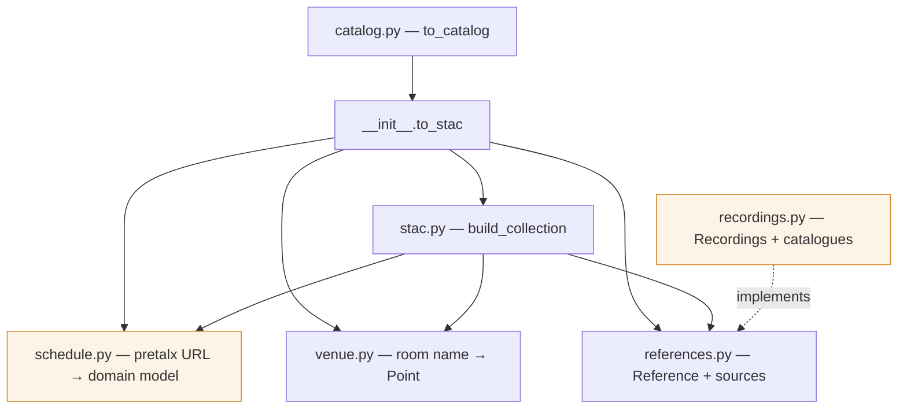

# Architecture

Only what the code cannot say for itself: the shape, the cross-module contracts,
and the reasoning behind the choices.

## Shape



`schedule`, `venue` and `references` know nothing about STAC or about each other.
`stac` depends on all three; nothing depends on `stac`. `catalog` sits above
`to_stac` and adds the one thing pretalx does not model — that several events
are one conference. Only `schedule` and `recordings` (shaded) touch the network.

## Contracts that span modules

- **Every session becomes an Item.** Breaks, poster slots and sponsor sessions
  included. Their nature is `talk:track` / `talk:type`, so there is no
  classification heuristic to get wrong and no exception for callers to remember.
- **`Venue.point_for` always answers.** An unknown room falls back rather than
  returning `None`, which is what keeps null-geometry handling out of `stac.py`
  and out of every downstream consumer.
- **A failing reference source cannot fail the transform.** `combine` isolates
  each one; a network source that is down costs recordings, not the Collection.
- **`Reference.kind` alone decides placement.** `stac.py` maps
  `RECORDING`/`RESOURCE` to assets and `MENTION` to `rel=related` links. A new
  source picks a kind and is done — it never learns that STAC exists.
- **Assets are things you retrieve; links are everything else.** The talk page
  and its slides are assets; the feedback form is a link, because there is
  nothing there to fetch.
- **A conference is not a pretalx event.** Talks, workshops and the academic
  programme are separate events with no link between them, and the naming is
  inconsistent (`foss4g-2024-workshop`, `foss4g-europe-2024-workshops`). Nothing
  can infer the grouping, so `catalog.py` takes it as data.
- **One matching rule, many platforms.** `Recordings` owns all of it —
  normalisation, the event tag, truncated titles, multiple recordings — and a
  platform contributes only a `VideoCatalogue`: its `source` name and
  `(title, url)` pairs.
- **A reference that names its platform is identified by it.** `stac.py` keys
  such an asset `recording-peertube` / `recording-youtube` and adds the platform
  to its roles, so a consumer filters on `roles` like any other STAC asset
  rather than parsing the href or learning a bespoke field.
- **Extents are derived from the Items**, never supplied.

## Decisions

| Chosen | Over | Because |
| --- | --- | --- |
| The frab export, `schedule/export/schedule.json` | The pretalx REST API | Public, complete, one request. The API needs a token and returns speakers by reference. |
| One `Schedule` module doing fetch *and* parse | `Fetcher` → `Parser` → … | Which URL holds the export and how that export is shaped are one decision that changes together. Splitting them is temporal decomposition into shallow layers. |
| One `Reference` with a `kind` | `AssetSource` + `LinkSource` | Two extension points, two compositions and two failure policies for one concept. |
| One `Recordings` over a `VideoCatalogue` | A class per platform | video.osgeo.org and YouTube title their videos identically. A class each would duplicate the matching rule and make every fix a two-file change. |
| A title matches when one continues the other at a word boundary | Exact match, plus a rule for truncation | One symmetric rule replaced two and covers what the data actually does: FOSS4G 2023 appends `- Speaker Name`, PeerTube truncates near 100 characters. It raised that conference from 29 to 202 matched recordings out of 296. |
| `event=` filters, and defaults to no filter | Defaulting to the session's year | The tag exists because a *channel* holds every year of a series. A playlist is already one conference and needs none, and inventing a year filter for it was a heuristic nobody asked for. |
| yt-dlp for YouTube listings | Scraping `ytInitialData`, or requiring an API key | The RSS feed stops at 15 of 140 entries; the page markup has already moved from `playlistVideoRenderer` to `lockupViewModel` and needs InnerTube continuation past 100. yt-dlp exists to absorb that churn. It is an optional extra, so nobody installs it for the OSGeo path. |
| Sources return plain `Reference` | Sources return `pystac.Asset` | Otherwise every source, including third-party ones, imports pystac and re-decides roles and media types. |
| Prose links are `rel=related` links | Prose links are assets | Asset keys would drown in sponsor URLs and personal homepages, and nothing would distinguish a slide deck from a passing mention. |
| Caller-supplied room coordinates | Geocoding room names | Non-deterministic, network-bound, and "Phoenix Hall" does not geocode. |
| Recordings opt-in | Recordings resolved inline | Keeps the default transform offline after the fetch, and mocks out of every mapper test. |
| One Collection per event URL | One Collection for a whole conference series | Workshops and the main track have different dates, rooms and licences. A parent Catalog composes trivially. |

Deferred: related-talk cross-references, the one link class not in the export.
HTML-only, one request per session, first thing to break on a template change.
It would be one more `ReferenceSource`.

## Quirks the code absorbs

Discovered against live data, and the reason `schedule.py` is defensive:

- Two export layouts. Some events nest `rooms`/`tracks`/`days` under `schedule`,
  others under `schedule.conference`.
- Some events omit the room block entirely, so the sessions are the only
  evidence a room exists.
- Sessions carry a start and a `"HH:MM"` duration, never an end.
- The same session is listed under every day and room it touches.
- Attachment URLs are site-relative; link URLs are not.
- Video collections truncate titles near 100 characters and keep every year of a
  conference series together, so a match needs both a prefix rule and an event
  tag. video.osgeo.org and YouTube both title entries `EVENT | Talk title`.
- A session can genuinely have several recordings (one FOSS4G Europe 2025 slot
  was filmed five times, on each platform).
- Video titles are not one format. `FOSS4G 2022 | Title`, `2023 | Title - Speaker`,
  `2023 Keynote | Title - Speaker`, and occasionally no bar at all.
- FOSS4G 2025 published its whole programme as one pretalx event: its workshops
  and academic papers are Items in the talks collection, told apart by `talk:type`.

## Testing

One integration test: `tests/fixtures/foss4g-europe-2025.schedule.json` — a real
capture, 153 sessions — through the whole transform to `validate_all()`. The
live-network version of it is marked `network` and deselected by default.

Everything else is unit tests against one module's public interface. No test
reaches into internals.

## Tooling

asdf pins the toolchain, uv resolves and runs, pre-commit gates ruff (lint +
format, Google docstrings), mypy strict, bandit, codespell and `uv lock --check`.

```sh
uv sync --extra dev
uv run pytest                    # add -m network for the live test
uv run pre-commit run --all-files
```
